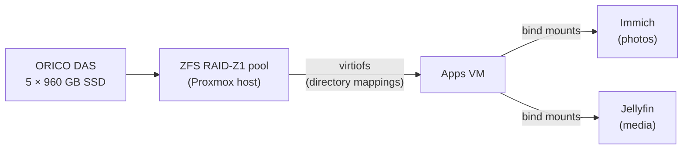

# Hardware

## Host

| Component | Details |
|---|---|
| **Model** | HP ProDesk 600 G4 DM (Desktop Mini) |
| **CPU** | Intel Core i5-8500T, 6 cores / 6 threads, 35 W TDP |
| **RAM** | 32 GB DDR4 SO-DIMM (2 × 16 GB) |
| **Hypervisor** | Proxmox VE 9.2 |

I chose a mini PC because it runs 24/7 with low power draw, heat, and noise. The i5-8500T is a low-power "T" model, which suits an always-on server.

## Internal Storage

| Drive | Proxmox storage | Holds |
|---|---|---|
| 256 GB NVMe | `local`, `local-lvm` | Proxmox OS, ISO images, container templates, backups |
| 2 TB SATA SSD | `vmdata` (LVM-Thin) | All VM disks |

The operating system, VM disks, and bulk data each live on separate storage. If I need to reinstall Proxmox, my VMs and files are not on that drive. VM disks are thin-provisioned, so each one only uses the space it has actually filled.

## External Storage (DAS)

| Component | Details |
|---|---|
| **Enclosure** | ORICO MixData Vault Big5 (model 8858RC3) |
| **Connection** | USB-A, USB 3.2 Gen 1 (5 Gbps) |
| **Drives** | 3 × Samsung PM883 960 GB (MZ7LH960HAJR), 2 × Toshiba 960 GB (THNSF8960PCSE) |
| **Layout** | ZFS RAID-Z1, managed by Proxmox (`das`) |
| **Capacity** | 4.8 TB raw, 3.37 TiB usable |

RAID-Z1 spreads data and parity across all five drives, so the pool survives one drive failing. The parity costs about one drive's worth of space. The Samsung PM883s are enterprise SSDs with high write endurance and power-loss protection.

### Directory Mappings

Folders on the pool are shared into VMs with virtiofs, using Proxmox directory mappings:

| Mapping | Host path |
|---|---|
| `documents` | `/das/vault/documents` |
| `media` | `/das/vault/media` |
| `photos` | `/das/vault/photos` |

## Virtual Machines

| VM | vCPUs | RAM | Disk | OS | Purpose |
|---|---|---|---|---|---|
| **Apps** | 4 | 16 GB | 120 GB | Ubuntu Server 26.04.1 LTS | Immich, Jellyfin (Docker) |
| **Minecraft** | 2 | 6 GB | 40 GB | Ubuntu Server 26.04.1 LTS | Paper Minecraft server (Docker, 4 GB allocated to the server) |

All 6 cores are assigned. Proxmox lets VMs share CPU time, and they rarely run at full load at once. About 10 GB of RAM is left unassigned for Proxmox itself and the ZFS cache (ARC).

## Storage Flow

## Known Limitations

- **ZFS over USB:** USB-to-SATA adapters can briefly disconnect drives, which ZFS may treat as failures, and can hide drive health data (SMART). All five drives also share a single 5 Gbps link. A future upgrade would be a SATA or SAS controller (HBA) in a machine with drive bays.
- **Backups on the boot drive:** Proxmox backups go to `local` on the same NVMe as the OS. If that drive fails, the OS and its backups are lost together.
- **RAID is not a backup:** RAID-Z protects against a drive failure, but not against accidental deletion, corruption from software, or ransomware. My photos need a separate backup copy.
- **All CPU cores assigned:** fine at current load, but heavy use on both VMs at once could slow them down.