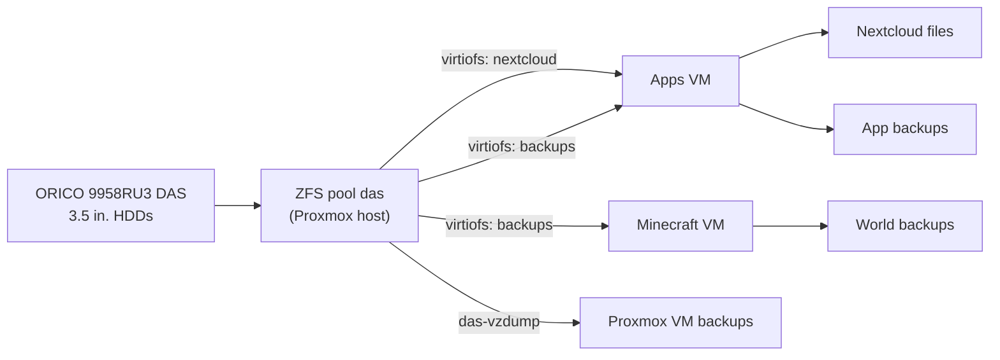

# Hardware

## Host

| Component | Details |
|---|---|
| **Model** | HP ProDesk 600 G4 DM (Desktop Mini) |
| **CPU** | Intel Core i5-8500T, 6 cores / 6 threads, 35 W TDP |
| **RAM** | 32 GB DDR4 SO-DIMM (2 × 16 GB) |
| **Hypervisor** | Proxmox VE 9.2 |

I chose a mini PC because it runs 24/7 with low power draw, heat, and noise. The i5-8500T is a low-power "T" model, which suits an always-on server.

## Internal Storage

| Drive | Proxmox storage | Holds |
|---|---|---|
| 256 GB NVMe | `local`, `local-lvm` | Proxmox OS, ISO images, container templates |
| 2 TB SATA SSD | `vmdata` (LVM-Thin) | All VM disks |

The operating system, VM disks, and bulk data each live on separate storage. VM disks are thin-provisioned, so each one only uses the space it has actually filled. VM backups now go to the DAS (`das-vzdump`) instead of the boot drive.

## External Storage (DAS)

| Component | Details |
|---|---|
| **Enclosure** | ORICO 5-Bay RAID enclosure (model 9958RU3), set to **Normal/Clear** mode (hardware RAID off) |
| **Connection** | USB-A, USB 3.0 (5 Gbps) |
| **Drives** | TODO: number × model, size (3.5" HDD) |
| **Layout** | ZFS TODO: RAID-Z2 / RAID-Z1 / mirror, pool `das` |
| **Capacity** | TODO: raw TB, usable TiB (from `zfs list das`) |

The enclosure can do hardware RAID, but it's set to Normal mode so each drive shows up separately and ZFS handles the redundancy. ZFS checksums every block, so it can detect and repair silent corruption, which the enclosure's hardware RAID can't. Its "JBOD"/"Span" mode would merge every drive into one disk, so it isn't used. The pool is created by [`proxmox/02-create-pool.sh`](../proxmox/02-create-pool.sh).

### Datasets

| Dataset | Path on host | Shared as (mapping) | Used by |
|---|---|---|---|
| `das/vault/nextcloud` | `/das/vault/nextcloud` | `nextcloud` → `/mnt/nextcloud` | Nextcloud user files |
| `das/vault/backups` | `/das/vault/backups` | `backups` → `/mnt/backups` | App backups (Apps VM), world backups (Minecraft VM) |
| `das/vzdump` | `/das/vzdump` | Proxmox storage `das-vzdump` | Nightly VM backups |

`das/vault` gets a recursive snapshot every day (14 kept).

### Previous DAS (retired November 2026)

ORICO MixData Vault Big5 (8858RC3) with 3 × Samsung PM883 and 2 × Toshiba 960 GB SSDs in RAID-Z1 (3.37 TiB usable). It was replaced to get more capacity from 3.5" hard drives. The pool was wiped, not migrated.

## Virtual Machines

Both VMs are created by [`proxmox/04-create-vms.sh`](../proxmox/04-create-vms.sh) from the Ubuntu 26.04 cloud image, with cloud-init setting up the user, SSH key and static IP.

| VM | vCPUs | RAM | Disk | OS | Purpose |
|---|---|---|---|---|---|
| **100 Apps** | 4 | 16 GB | 120 GB | Ubuntu Server 26.04 LTS | Nextcloud, Vaultwarden, AdGuard Home (Docker) |
| **101 Minecraft** | 2 | 6 GB | 40 GB | Ubuntu Server 26.04 LTS | Paper Minecraft server + backups (Docker), playit agent |

All 6 cores are assigned. Proxmox lets VMs share CPU time, and they rarely run at full load at once. About 10 GB of RAM is left unassigned for Proxmox itself and the ZFS cache (ARC).

## Storage Flow

## Known Limitations

- **ZFS over USB:** USB-to-SATA adapters can briefly disconnect drives, which ZFS may treat as failures, and they hide some drive health data (SMART needs `smartctl -d sat`). All drives share a single 5 Gbps link. Some ORICO multi-bay enclosures report duplicate disk IDs, so check `zpool status` after every host reboot. A future upgrade would be a SATA or SAS controller (HBA) in a machine with drive bays.
- **Drive sleep:** the 9958RU3 spins drives down after about 10 minutes idle, so the first access after a pause is slow.
- **Backups share a box with the data:** snapshots, app backups and VM backups all live on the same DAS. They protect against mistakes, corruption and a single drive failure, but not against losing the enclosure or the house. An off-site copy is on the roadmap.
- **All CPU cores assigned:** fine at current load, but heavy use on both VMs at once could slow them down.
