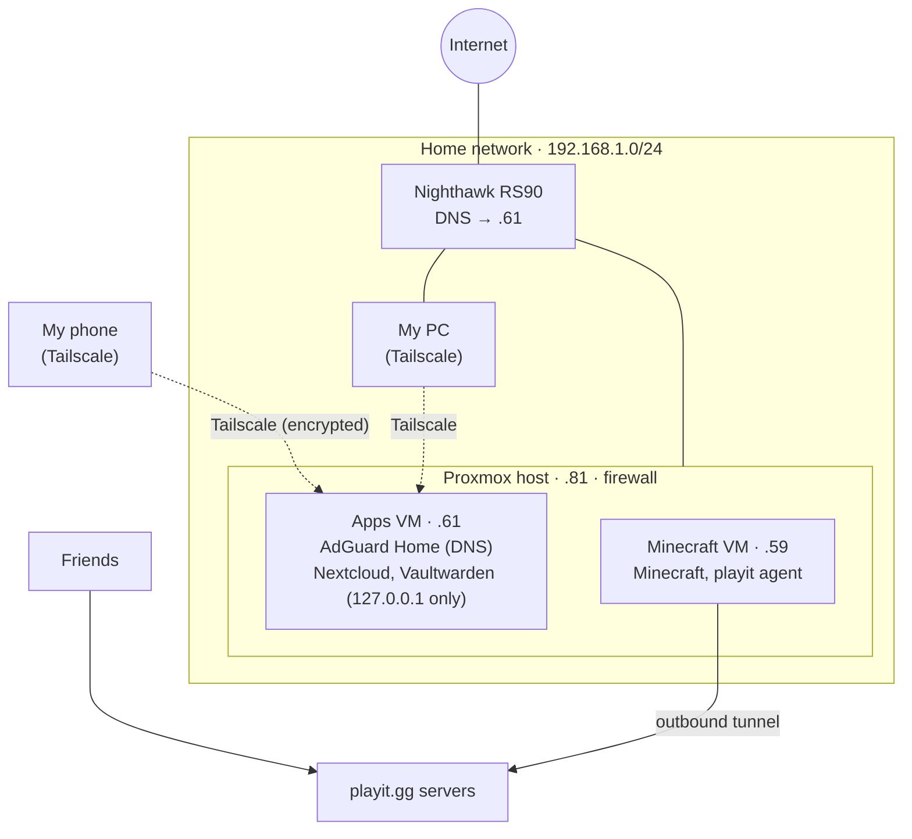

# Network

## Overview

| | |
|---|---|
| **Router** | Netgear Nighthawk RS90 |
| **LAN** | 192.168.1.0/24 |
| **DNS** | AdGuard Home on the Apps VM (LAN + tailnet) |
| **Remote access** | Tailscale (Apps VM, my phone, my PC) |
| **Public access** | playit.gg tunnel (Minecraft only) |
| **Open ports on router** | None |
| **Firewall** | Proxmox firewall on the host and both VMs, default deny inbound |

The Proxmox host connects to the LAN, and both VMs connect through the host's network bridge (`vmbr0`), so each VM appears on the network as its own device with its own IP.

## IP Plan

| Device | IP | How it's assigned |
|---|---|---|
| Nighthawk RS90 | 192.168.1.1 | Gateway |
| Proxmox host | 192.168.1.81 | Static on host, plus a DHCP reservation on the router |
| Apps VM | 192.168.1.61 | Static (cloud-init), plus a DHCP reservation for the same MAC |
| Minecraft VM | 192.168.1.59 | Static (cloud-init), plus a DHCP reservation for the same MAC |

The VMs set their own addresses through cloud-init, so a router reset doesn't move them. The router reservations stay in place so the router never hands those addresses to another device. When the VMs were rebuilt, `01-teardown.sh` saved the old MAC addresses and the new VMs reuse them.

## DNS: AdGuard Home

- The router gives out `192.168.1.61` as the DNS server, so every device at home filters ads and trackers through AdGuard Home.
- The tailnet uses the Apps VM's Tailscale IP as its DNS server (with *Override local DNS*), so my phone is filtered away from home too.
- AdGuard forwards queries upstream over encrypted DNS-over-HTTPS (Quad9, Cloudflare).
- The VMs and host use public DNS (1.1.1.1, 9.9.9.9) directly, so if AdGuard breaks, the servers can still update and resolve names.

## Remote Access: Tailscale

Tailscale runs on the Apps VM, my phone, and my PC. Nextcloud and Vaultwarden don't listen on the LAN at all (they're bound to `127.0.0.1`). **Tailscale Serve** on the Apps VM is the only way in, and it provides HTTPS with a valid certificate for the VM's tailnet name:

| URL | Service |
|---|---|
| `https://apps.<tailnet>.ts.net` | Nextcloud |
| `https://apps.<tailnet>.ts.net:8443` | Vaultwarden |

This follows the **principle of least privilege**: the Proxmox host and the Minecraft VM are not on the tailnet, and nothing on the LAN can reach the password manager without Tailscale.

## Public Access: playit.gg

Friends connect to the Minecraft server through playit.gg without any port forwarding:

1. The playit agent (a systemd service on the Minecraft VM) opens an **outbound** connection to playit.gg and keeps it open.
2. Friends connect to my playit.gg address, never my home IP.
3. playit.gg sends their traffic back through that open connection.
4. The agent passes it to the Minecraft container on port 25565, which only lets whitelisted players in.

## Ports & Firewall

The Proxmox firewall (rules in [`proxmox/firewall/`](../proxmox/firewall/)) filters at the host's bridge, before traffic reaches a VM. That avoids the usual problem of Docker-published ports bypassing ufw inside the VM.

| Target | Port | Allowed from |
|---|---|---|
| Proxmox host | 8006 (web UI), 22 (SSH) | LAN |
| Apps VM | 22 (SSH) | LAN |
| Apps VM | 53 TCP/UDP (DNS) | LAN |
| Apps VM | 3000 (AdGuard admin) | LAN |
| Apps VM | 41641 UDP (Tailscale direct connections) | Anywhere |
| Minecraft VM | 22 (SSH), 25565 (Minecraft) | LAN |
| Nextcloud, Vaultwarden | 8081, 8082 on `127.0.0.1` | Only inside the Apps VM (through Tailscale Serve) |

Everything else inbound is dropped. Outbound is allowed.

## Current Security Posture

- **No inbound ports open on the router.** Nothing on the internet can start a connection into my network.
- **Default-deny firewall** on the host and both VMs.
- **Key-only SSH** everywhere, two-factor on the Proxmox web UI.
- **Flat network.** Servers share the same network as my personal devices. The RS90 doesn't support internal VLANs, so separating them requires a managed switch.
