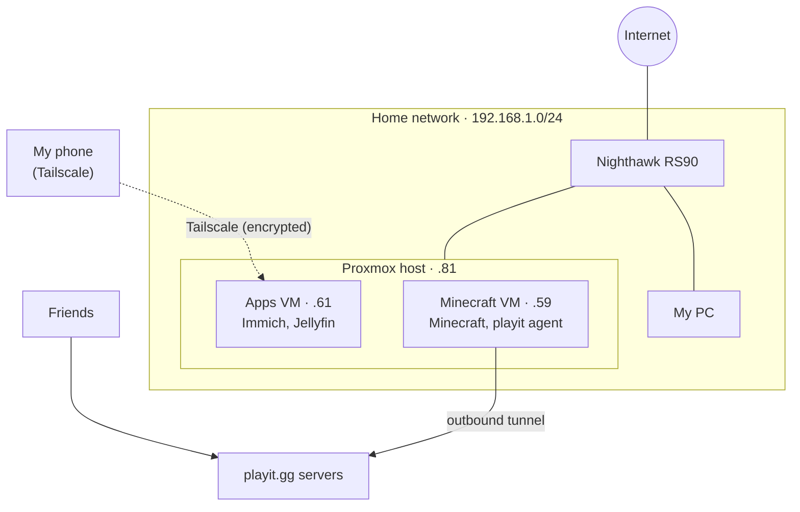

# Network

## Overview

| | |
|---|---|
| **Router** | Netgear Nighthawk RS90 |
| **LAN** | 192.168.1.0/24 |
| **Remote access** | Tailscale (Apps VM only) |
| **Public access** | playit.gg tunnel (Minecraft only) |
| **Open ports on router** | None |

The Proxmox host connects to the LAN, and both VMs connect through the host's network bridge (`vmbr0`), so each VM appears on the network as its own device with its own IP.

## IP Plan

| Device | IP | How it's assigned |
|---|---|---|
| Proxmox host | 192.168.1.81 | Static on host, plus a DHCP reservation on the router |
| Apps VM | 192.168.1.61 | DHCP reservation on the router |
| Minecraft VM | 192.168.1.59 | DHCP reservation on the router |
|Nighthawk RS90| 192.168.1.1| gateway

The VMs use DHCP reservations, so all addresses are managed in one place on the router and can't accidentally be assigned twice. The tradeoff is that a router reset or a recreated VM (new MAC address) means updating the reservations.

## Remote Access: Tailscale

Tailscale is installed only on the Apps VM, and my phone is the only other device on the tailnet. Away from home, my phone can reach Immich and Jellyfin through their iOS apps, and nothing else.

This follows the **principle of least privilege**: the Proxmox host, the Minecraft VM, and the rest of my home network are not reachable through Tailscale at all. The tradeoff is that I can't manage Proxmox remotely. Tailscale's subnet router feature could expose more of the LAN later if needed.

## Public Access: playit.gg

Friends connect to the Minecraft server through playit.gg without any port forwarding:

1. The playit agent (a systemd service on the Minecraft VM) opens an **outbound** connection to playit.gg and keeps it open.
2. Friends connect to my playit.gg address, never my home IP.
3. playit.gg sends their traffic back through that open connection.
4. The agent passes it to the Minecraft container on port 25565.

Because the connection starts from inside my network, the router allows it without any open inbound ports, and my home IP stays hidden from players.

## Ports

| Service | Port | Reachable from |
|---|---|---|
| Proxmox web UI | 8006 | LAN |
| Immich | 2283 | LAN, Tailscale |
| Jellyfin | 8096 | LAN, Tailscale |
| Minecraft | 25565 | LAN, playit.gg tunnel |

## Current Security Posture

- **No inbound ports open on the router.** Nothing on the internet can start a connection into my network.
- **No host firewalls yet.** ufw is inactive on both VMs, so any device on my LAN can reach any open port on them. This is a roadmap item. Docker-published ports bypass ufw by default, so I plan to use the Proxmox firewall instead.
- **Flat network.** Servers share the same network as my personal devices. The RS90 doesn't support internal VLANs, so separating them requires a managed switch.